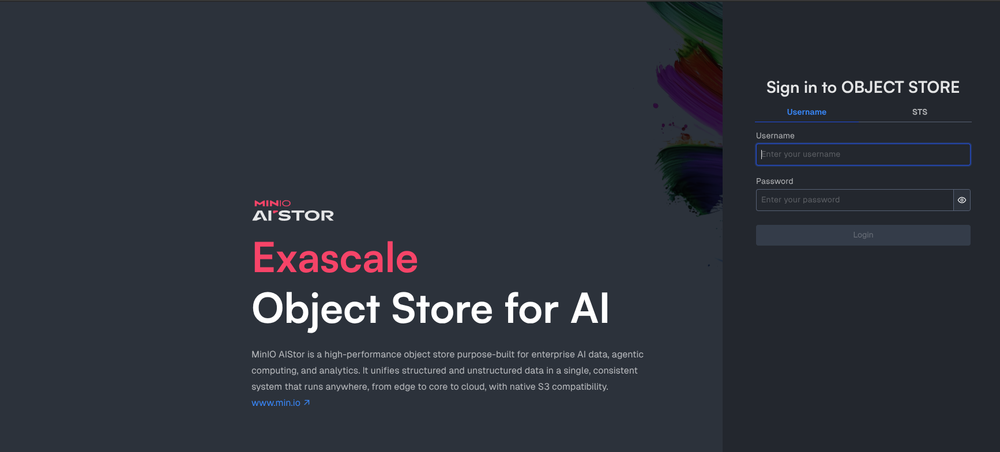
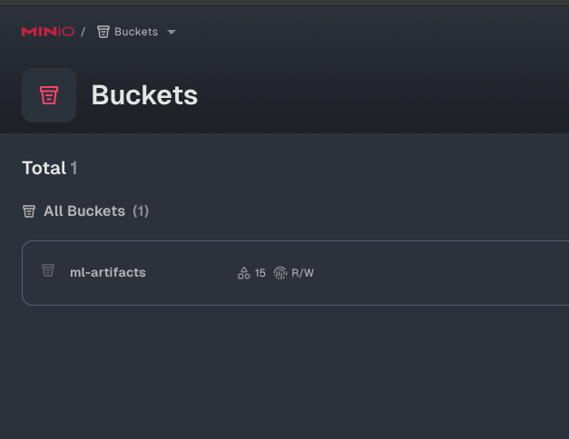
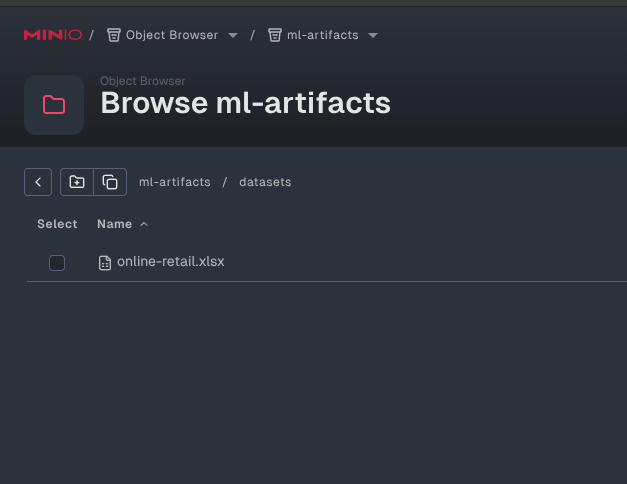

# High Value Customer Laboratory

This laboratory demonstrates an end-to-end predictive machine learning workflow on Red Hat OpenShift AI. It covers object storage, pipeline execution, model training, model deployment, and prediction testing through a Streamlit application.

The project uses:

- Python 3.11
- OpenShift 3.5.2
- AIStor MinIO for object storage
- Red Hat OpenShift AI for pipelines and model serving
- Kubeflow Pipelines for the training workflow
- MLServer and KServe for model deployment
- Scikit-learn for model training
- Streamlit for the customer prediction interface

## Laboratory Flow

The main resources in this repository are used in the following order:

1. Create the local Python environment.
2. Deploy AIStor MinIO to OpenShift.
3. Install the required Red Hat OpenShift AI subscriptions.
4. Enable the OpenShift AI components.
5. Create the project, secrets, and data science pipeline application.
6. Compile and import the training pipeline.
7. Run the pipeline and verify the generated artifacts.
8. Deploy the trained model.
9. Run the Streamlit application and test an inference request.

## Repository Structure

The repository is organized around the resources used at each stage:

- `minio-aistor/` contains the namespace, license and credential Secrets, storage, deployment, Service, and Routes for AIStor.
- `openshift-ai/subscriptions/` contains the operator subscriptions used by the laboratory.
- `openshift-ai/rhoai/` contains the OpenShift AI cluster configuration and related platform resources.
- `openshift-ai/high-value-customer/` contains the data science project, pipeline application, and MinIO connection Secrets.
- `pipelines/` contains the Kubeflow pipeline source and the compiled pipeline YAML.
- `openshift-ai/deploy/` contains the model ServingRuntime and InferenceService manifests.
- `ui/app.py` contains the Streamlit prediction interface.
- `datasets/` contains the source and example datasets.
- `.env` contains the model endpoint and MinIO addresses used by the local application and documentation.

Run all commands from the root directory of this repository unless a command explicitly changes directory.

## 1. Prepare the Local Python Environment

Create and activate a Python virtual environment. Using a virtual environment keeps this laboratory's packages separate from the rest of the Python installation.

```bash
python -m venv .venv
source .venv/bin/activate
pip install -r requirements.txt
```

The virtual environment should remain active while running the pipeline generator and the Streamlit application.

## 2. Provision AIStor MinIO

The AIStor deployment requires a personal license. Generate it using the official procedure:

- <https://docs.min.io/aistor/operations/licenses/>

Before applying the manifests, update the following files with the values required for this laboratory:

- `minio-aistor/secret-minio-aistor-license.yaml`: add the generated license to the `minio.license` key.
- `minio-aistor/secret-minio-aistor-credentials.yaml`: review and set the MinIO administrator credentials.

Do not use placeholder or default credentials outside of an isolated laboratory environment.

Create the `aistor` namespace and apply the remaining AIStor manifests:

```bash
oc apply -f minio-aistor/namespace.yaml
oc apply -f minio-aistor/
```

The first command creates the namespace. The second command applies the license and credential Secrets, persistent storage, Deployment, Service, and Routes from the `minio-aistor/` directory.

Watch the pods until they enter the `Running` state:

```bash
oc get pods -w -n aistor
```

Press `Ctrl+C` when the pod status is satisfactory and the pod is ready.

This is the expected outcome. Use the credentials stored in the **secret-minio-aistor-credentials.yaml** file to login:



### Configure the Local Environment

Update the `MINIO_SVC` value in `.env` with the MinIO service address. For the manifests in this repository, the internal address is:

```text
http://aistor.aistor.svc.cluster.local:9000
```

### Create the MinIO Object Storage Structure

Create the `ml-artifacts` bucket. Inside that bucket, create a `datasets` directory and upload `datasets/online-retail.xlsx`.

The training pipeline uses the following object key:

```text
ml-artifacts/datasets/online-retail.xlsx
```

1. The `ml-artifacts` bucket



2. The input dataset



The following MinIO documentation references provide additional installation and deployment information:

- <https://docs.min.io/aistor/installation/kubernetes/install/deploy-aistor-on-openshift/#create-the-minio-aistor-namespace>
- <https://docs.min.io/aistor/installation/container/install/>

## 3. Install the Red Hat OpenShift AI Operators

Apply the operator subscriptions in the `openshift-ai/subscriptions/` directory:

```bash
oc apply -f openshift-ai/subscriptions/rho-ai-subscription.yaml
oc apply -f openshift-ai/subscriptions/rho-serverless-subscription.yaml
oc apply -f openshift-ai/subscriptions/authorino-subscription.yaml
oc apply -f openshift-ai/subscriptions/rho-pipelines-subscription.yaml
```

Wait until the required operator installations complete before continuing.

> [!NOTE]
> All operators status must be in "✅ Succeeded" status.

## 4. Provision OpenShift AI

Apply the DataScienceCluster manifest:

```bash
oc apply -f openshift-ai/rhoai/datasciencecluster.yaml
```

This resource enables the OpenShift AI components configured in `datasciencecluster.yaml`, including AI pipelines and KServe model serving.

> [!NOTE]
> Don't be scared if the DataScienceCluster has the "Phase: 🚫 Not Ready" status. Maybe some components are not ready when you try to run this doc. During the construction of this lab the *trainer* component wasn't ready.

## 5. Configure the High Value Customer Project

Create the `high-value-customer-ml` data science project:

```bash
oc apply -f openshift-ai/high-value-customer/high-value-customer-ml-datascienceproject.yaml
```

### Configure the MinIO Connection

Update the following manifest files with the MinIO connection information:

- `openshift-ai/high-value-customer/ml-artifacts-dataconnection.yaml`
- `openshift-ai/high-value-customer/dashboard-dspa-secret.yaml`

Set the access key and secret key consistently with the credentials configured in `minio-aistor/secret-minio-aistor-credentials.yaml`. The endpoint must match the address used to reach MinIO.

Apply the connection Secrets:

```bash
oc apply -f openshift-ai/high-value-customer/ml-artifacts-dataconnection.yaml
oc apply -f openshift-ai/high-value-customer/dashboard-dspa-secret.yaml
```

### Create the Data Science Pipelines Application

Apply the DataSciencePipelinesApplication manifest:

```bash
oc apply -f openshift-ai/high-value-customer/datasciencepipelinesapplication.yaml
```

This manifest creates the pipeline application in the `high-value-customer-ml` project and configures external object storage to use the `ml-artifacts` bucket.

If MinIO is deployed in a namespace other than `aistor`, update the `host`, `scheme`, and related endpoint values in the pipeline and connection manifests. Keep the endpoint, namespace, bucket, and credential configuration consistent across the resources.

## 6. Generate and Import the Training Pipeline

Generate the Kubeflow pipeline YAML from the Python pipeline definition:

```bash
python pipelines/high_value_customer_pipeline.py
```

The command generates `pipelines/high-value-customer-training.yaml` in the `pipelines/` directory.

In the OpenShift AI dashboard:

1. Open the `high-value-customer-ml` project.
2. Open the **Pipelines** section (tab).
3. Import `pipelines/high-value-customer-training.yaml`.
4. Set the pipeline name to `high-value-customer-training`.
5. Add a clear description for the pipeline.

The pipeline workflow has two stages:

1. Feature engineering downloads the retail dataset from MinIO, cleans and aggregates the customer data, calculates prediction features, and creates the training target.
2. Training, evaluation, and storage split the data, train Logistic Regression and Random Forest models, select the model with the best PR-AUC score, and upload the resulting artifacts to MinIO.

Although this pipeline import is performed through the OpenShift AI interface, the corresponding Kubernetes resources belong to the `pipelines.kubeflow.org` API group.

## 7. Run the Training Pipeline

Create a pipeline run and assign it a name.

Review the pipeline logs while the run executes. A successful run reaches the `Complete` or `Succeeded` state.

After the run succeeds, inspect the `ml-artifacts` bucket. The pipeline creates or updates:

- `models/`: contains the pipeline evaluation artifacts and the trained model files.
- `high-value-customer-training/`: contains pipeline-related artifacts.

The deployed model is saved as `models/best_model.joblib` in the Joblib format.

## 8. Deploy the Trained Model

Apply the model serving runtime:

```bash
oc apply -f openshift-ai/deploy/serving-runtime.yaml
```

Then apply the inference service:

```bash
oc apply -f openshift-ai/deploy/inference-service.yaml
```

The ServingRuntime defines MLServer as the model server. The InferenceService configures KServe to load `models/best_model.joblib` through the `ml-artifacts` connection.

Check the deployed resources and pod status:

```bash
oc get inferenceservice -n high-value-customer-ml
oc get pods -n high-value-customer-ml
oc logs -n high-value-customer-ml <predictor-pod-name>
```

The predictor pod name has the following pattern:

```text
<namespace>-predictor-<hash-id>-<pod-id>
```

For example:

```text
high-value-customer-predictor-5d768df4f5-mktwj
```

Wait until the InferenceService and its predictor pod are ready. Then obtain the external route created for the model endpoint and update `MODEL_ENDPOINT` in `.env`:

```bash
oc get route -n high-value-customer-ml
```

Set `MODEL_ENDPOINT` to the external HTTPS address of the InferenceService route. Keep `MODEL_NAME` set to `high-value-customer`, as defined by the manifests and application.

## 9. Test the Deployed Model

Run the Streamlit application:

```bash
streamlit run ui/app.py
```

Open the URL printed by Streamlit. Enter customer purchasing information in the application and select **Analyze customer**.

The application sends a KServe V2 inference request to the deployed model and displays class `1` for a high value customer or class `0` for a standard value customer. Expand the technical sections in the interface to review the request JSON and the raw model response.
